<p align="center">
  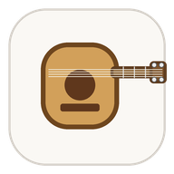
</p>

<h1 align="center">ukemusic</h1>

<p align="center">
  <b>Bring your songs. Learn them, practise them, play them together.</b><br>
  Type the words with the chords in square brackets: ukemusic draws the chord sheet, the shapes and the strum,<br>
  plays it with you, helps you learn it by heart, and prints it for the gig.
</p>

<p align="center">
  <a href="https://markbeachill.github.io/ukemusic/"><b>Website</b></a> ·
  <a href="https://markbeachill.github.io/ukemusic/app/"><b>Try it in your browser</b></a> ·
  <a href="https://github.com/markbeachill/ukemusic/releases/latest"><b>Download</b></a> ·
  <a href="https://markbeachill.github.io/ukemusic/gallery.html"><b>Gallery</b></a>
</p>

<p align="center">
  <a href="https://github.com/markbeachill/ukemusic/releases/latest"></a>
  <a href="https://github.com/markbeachill/ukemusic/actions/workflows/test.yml"></a>
  <a href="LICENSE"></a>
  
</p>

<p align="center">
  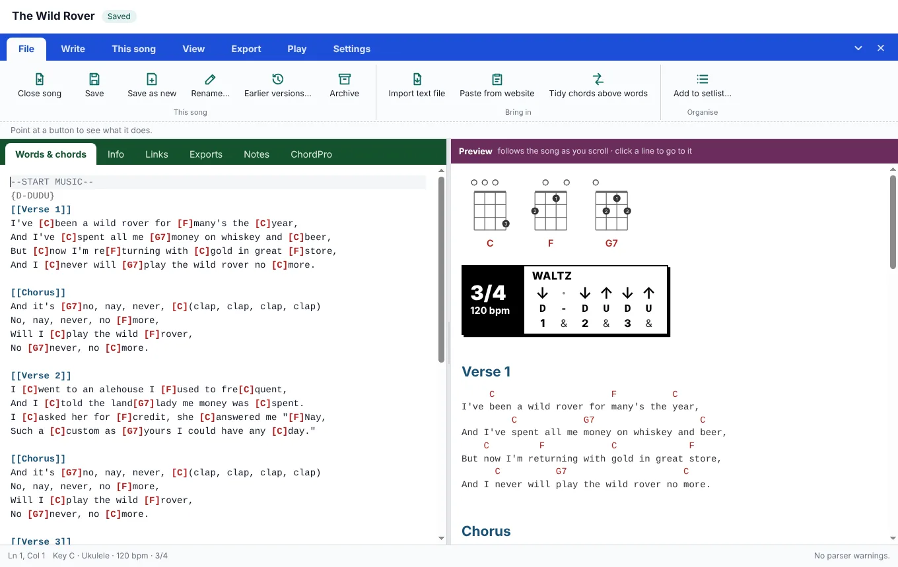
</p>

Free and open source, for ukulele first, with baritone ukulele and guitar too. A desktop app for Windows, Mac and Linux, and a web player for phones, tablets and any browser.

## Write it like this

```text
--START MUSIC--
[[Verse 1]]
{3/4 D-DUDU}
I've [C]been a wild rover for [F]many's the [C]year,
And I've [C]spent all me [G7]money on whiskey and [C]beer
--END MUSIC--
```

The chords go in square brackets where they're played; `{D-DU-UDU}` is the strum. Or paste a chord sheet from a website, import ChordPro, a songbook or a PDF, and ukemusic writes it this way for you. Everything you can type: [WRITING.md](WRITING.md).

## A quick tour

<table>
<tr>
<td width="50%">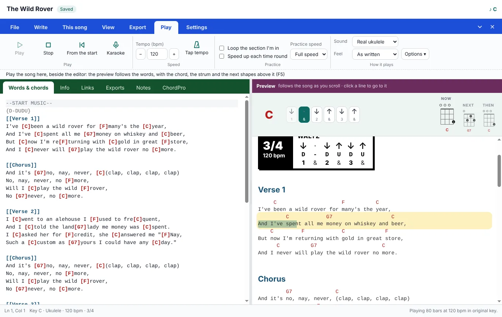<br><b>Play along.</b> It strums the song with real ukulele sounds; the line, the chord and the strum light up as they come, with the next shapes ready.</td>
<td width="50%">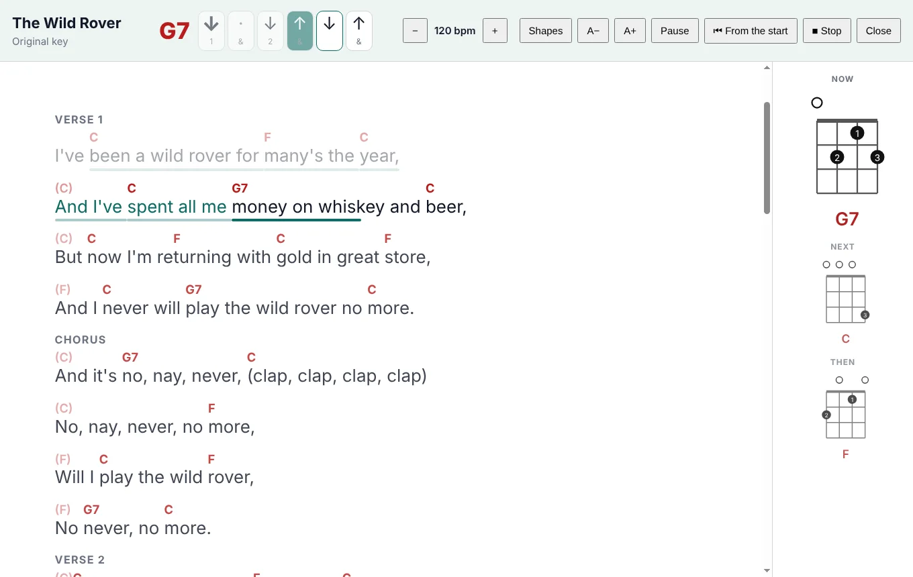<br><b>Karaoke.</b> Full screen, big words lit as they're sung, and the chord shapes for now, next and then.</td>
</tr>
<tr>
<td>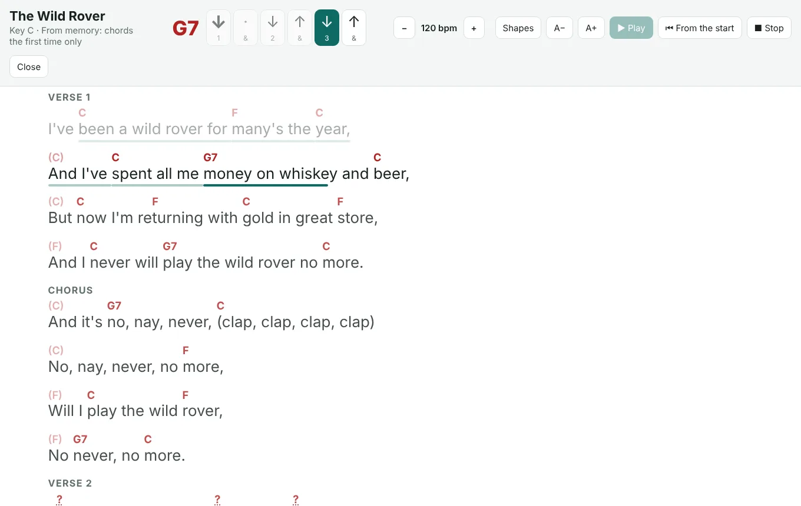<br><b>Learn it by heart.</b> The chords fade after the first time each part comes, then show as numbers, then go.</td>
<td>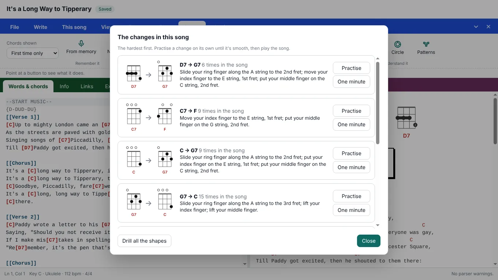<br><b>The hard changes, first.</b> Every chord change in the song, with what each finger does, and practice for each.</td>
</tr>
<tr>
<td>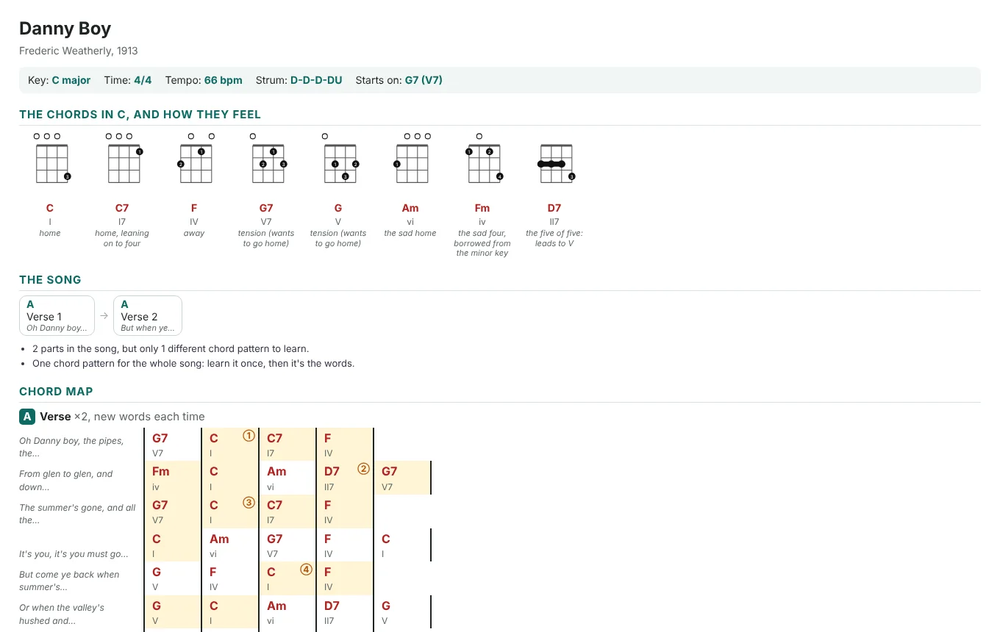<br><b>Learn sheets.</b> The chords and what each one does, the song's parts, the chord map with its patterns, and the circle of fifths.</td>
<td>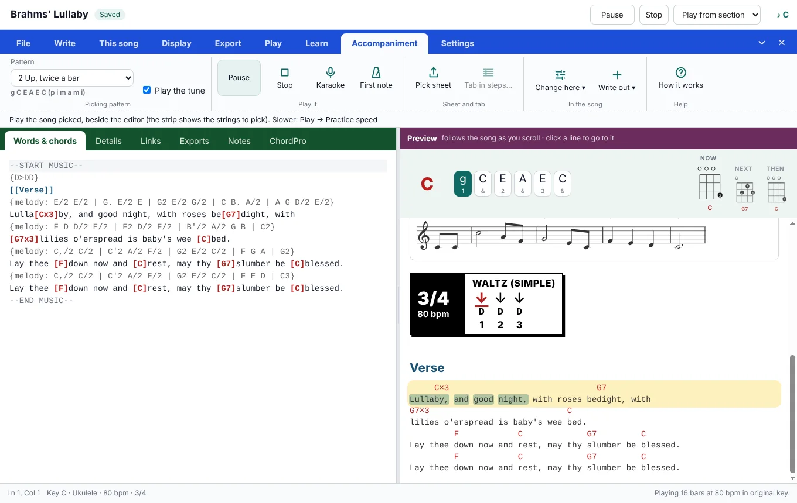<br><b>Fingerpick it, with the tune.</b> Picking patterns, tab, and the tune drawn as notes on a staff.</td>
</tr>
<tr>
<td>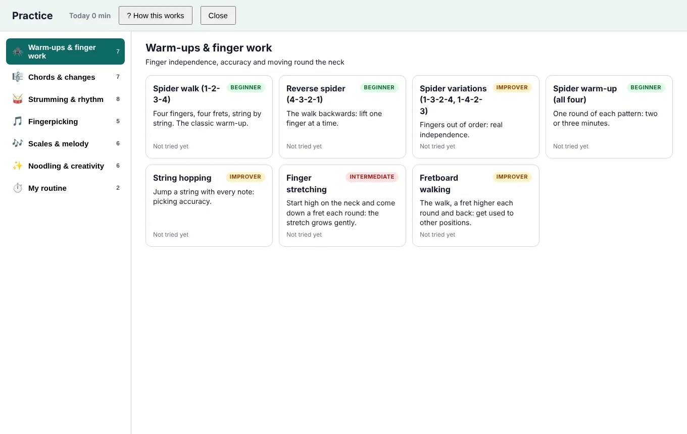<br><b>Free Practice.</b> 39 exercises: warm-ups, chord changes, strumming, picking, scales and noodling, with routines and your progress.</td>
<td>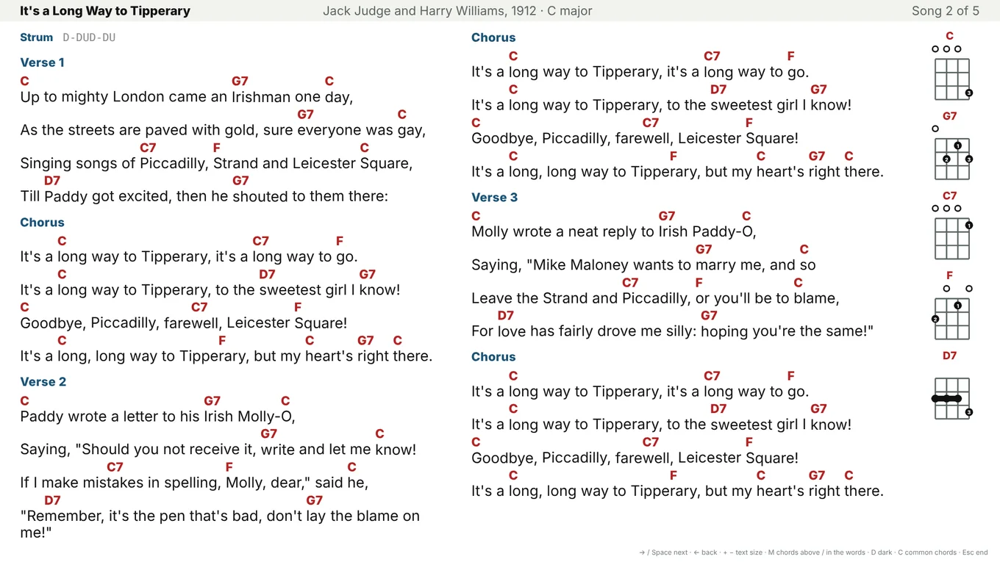<br><b>Play together.</b> Setlists, songbook PDFs, and the Session screen: the whole song on the TV for a club night.</td>
</tr>
<tr>
<td>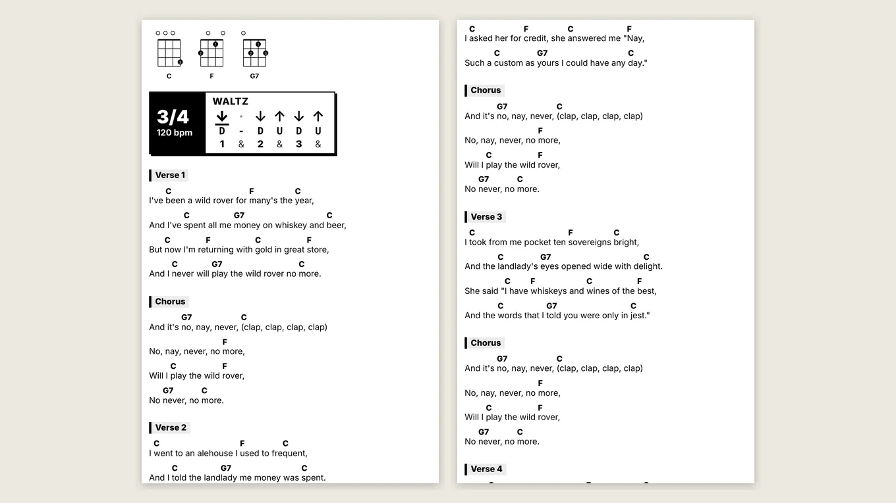<br><b>Print it for the gig.</b> A chord sheet in your own style and a Stage copy: big plain words, the chords in them, the fewest pages. <a href="https://markbeachill.github.io/ukemusic/gallery.html">See the gallery</a>.</td>
<td>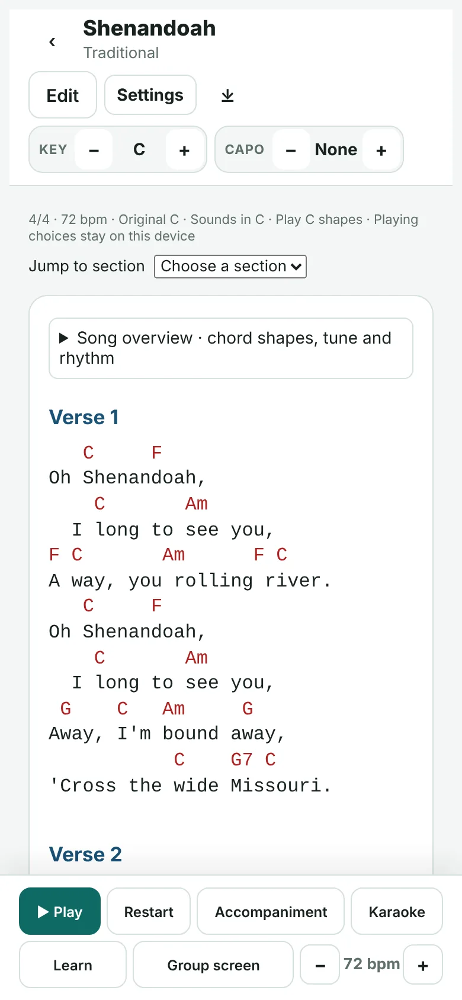 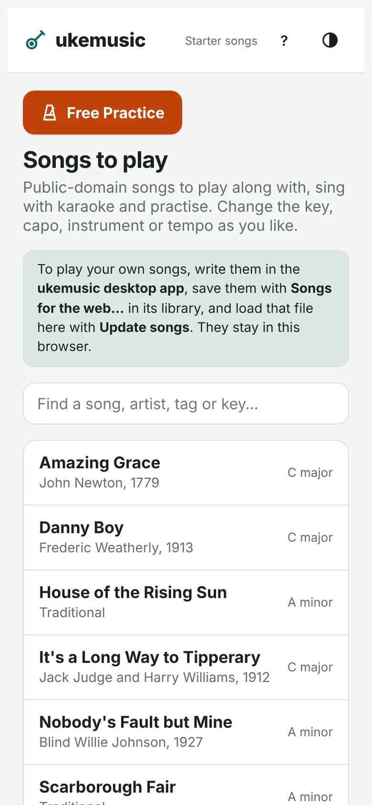<br><b>On a phone or tablet.</b> The web player plays, edits and keeps songs, and can share a Dropbox songs folder with the desktop app.</td>
</tr>
</table>

## Get it

- **In your browser:** [the web player](https://markbeachill.github.io/ukemusic/app/), nothing to install. Add it to your Home Screen to use it offline.
- **On your computer:** [the latest release](https://github.com/markbeachill/ukemusic/releases/latest): a Windows installer, Mac disk images (Apple silicon and Intel) and a Linux AppImage. They aren't code-signed, so Windows and macOS ask once before opening them; [the website](https://markbeachill.github.io/ukemusic/#get) says how.
- **From the source:** `npm install`, then `npm start` (see [Development](#development)).

## The guides

| | |
|---|---|
| [WRITING.md](WRITING.md) | How to write songs: everything you can type, with examples (also in the app: Write → How to write) |
| [INSTRUMENTS.md](INSTRUMENTS.md) | Ukulele, baritone and guitar: file names, capo, left-handed, sounds, the strum library |
| [TABLATURE.md](TABLATURE.md) | Tab: writing, pasting, key changes, other instruments, playback |
| [CHORDPRO.md](CHORDPRO.md) | What ukemusic reads and writes in ChordPro, and what it adds |
| [How ukemusic helps you learn a song](docs/explanation/learning-a-song.md) | How Learn works out a song, and how far to trust it |
| [CHANGELOG.md](CHANGELOG.md) | What's changed in each version |

The guides and the changelog are pages of [the website](https://markbeachill.github.io/ukemusic/) too, made from these files.

## Getting around the desktop app

- ukemusic opens on **Your songs** (the library): open a song, start a new one, paste one from a website or import a file. Three old, copyright-free starter songs show how songs are written.
- In a song, the tabs hold everything (File → Close goes back to your songs). **View** has the look (diagrams, text size, strum style, layout) and **Export** makes PDFs and other files in one click:
  - **File**: close, save, save as new, rename, import, paste, add to setlist;
  - **Write**: tab, strums, suggest the key, chords into words (for songs copied from websites), How to write (the guide);
  - **This song**: key, capo, instrument, tempo, time, strum;
  - **Play**: play (beside the editor, with the chord, strum and next shapes above the preview), play along (full-screen karaoke with chord shapes), Session screen (the whole song on one screen, on the TV if one is plugged in, for playing as a group; a setlist song by song), stop, practice (strum, 12-bar blues, chord change), tempo (change it while playing), tap tempo, practice (loop a section, slower, speeding up), sound;
  - **Learn**: play from memory (the chords fading), a what-comes-next quiz, trouble spots to loop, the circle of fifths, the song's changes with what each finger does (and practice for each), numbers on the sheet, play it in another key, and a learn sheet (PDF and web page in the song's learn folder). How it works out a song, and how far to trust it: [How ukemusic helps you learn a song](docs/explanation/learning-a-song.md);
  - **Settings**: opens Settings.
- The hint line under the tabs explains whatever the mouse is over.
- **Free Practice**: 39 exercises for warm-ups, chords, rhythm, fingerpicking, scales and improvisation, plus timed routines. Exercises open directly with optional help just for that exercise. The last three started exercises, your settings, scores and routines are kept between visits. Phones have a compact playing view; one-minute changes lets you enter your count afterwards. Practice backups are separate from song backups.
- The library's **Setlists** tab puts songs in order for a gig or club night and makes a **songbook PDF**. Songs can have an artist and tags to search by.
- A song can be kept in several keys; each shows in the library as "Song (in F)", and **Make this the song's key** rewrites the song itself in a new key.
- Each song has an **Info** tab (artist, year, written by, album, source, tags, difficulty, original key, time, tempo) beside Song and Notes. A song always opens on the Song tab.
- Click a chord diagram to choose another **chord shape** for the song.
- Shorthand: `[Em:2]` for a 2-beat chord, `[N.C.]` for a pause, `[C x3]` for three bars, `| C | F | % | G7 C |` for a line of bars, `(x2)` to repeat a line, `{A: D-DU-UDU}` … `{A}` for named strums, `{stop}`.
- **View → Layout**: chords above the words, in columns, in the words, or chords only.
- Strum patterns show as **info boxes** (time signature, name, arrows, letters, count), in a choice of styles including plain; `{3/4 D-DUDU}` changes the time from there on.
- The song is on the left and its preview on the right, kept in step: scroll the song and the preview follows; click a preview line to jump to it in the song.

## The website and releases

- **Website:** https://markbeachill.github.io/ukemusic/ (what ukemusic does, with downloads). Its page is `site/index.html`; it finds the repository and the latest release by itself.
- **Web player:** https://markbeachill.github.io/ukemusic/app/ (for phones, tablets and any browser: play, write and edit songs, and use Free Practice; see [web/README.md](web/README.md)). It opens with public-domain songs; add your own from files, a desktop export or a shared Dropbox songs folder. Practice history stays on each device and has its own backup.
- **Installers:** made by GitHub Actions for each release (`.github/workflows/release.yml`): a Windows installer, Mac disk images (Apple silicon and Intel) and a Linux AppImage. They aren't code-signed, so Windows and macOS ask once before opening them; the website says how.

Both the website and the web player are rebuilt on every push to `main` (`.github/workflows/web.yml`).

### Making a release

1. Change `"version"` in `package.json` (and add a section to CHANGELOG.md), commit and push.
2. On GitHub: **Releases → Draft a new release**, tag `v` + the version (e.g. `v4.33.1`), paste the changelog section, **Publish release**.
3. The installers appear on the release after about 15 minutes, and the website's download buttons point at them. Songs come from the desktop app's **Songs for the web…** file, loaded with **Update songs**. 

## Songs and copyright

This repository holds **no copyrighted songs**. Your own songs folder (`mysongs/`), exports and the working files are kept out by `.gitignore`. The examples in the guide and the tests use public-domain words (Oh! Susanna, Clementine, Amazing Grace, Scarborough Fair) or words written for the tests.

`public domain songs/Public Domain Songs/` is a ukemusic library of songs that are free of copyright in the UK. Each song's `notes.txt` says why, and songs tagged **needs words** have their details but no words yet. Add it in the app with the library button → **Add a library folder…**. Before adding a song to it, check that the words and the music are both out of copyright (in the UK, 70 years after the death of the last writer), and set Info → Licence.

## Development

```bash
npm install
npm test          # run all tests
npm start         # launch in dev mode
npm run build:web # the web player, into web/out (see web/README.md)
```

## Building

```bash
# Unpacked build (for testing production paths)
npm run build

# Platform installers
npm run package:linux   # → dist/*.AppImage
npm run package:mac     # → dist/*.dmg
npm run package:win     # → dist/*.exe (NSIS installer)

# All platforms (from a CI environment)
npm run package
```

Output goes to `dist/`.

## Project structure

```
main.js              Electron main process
preload.js           → delegates to src/preload.js
index.html           Single-page app shell (editor + preview + settings)
src/
  parser.js          Input → IR nodes (pure function)
  renderer-html.js   IR → HTML string (pure function)
  renderer-markdown.js IR → Markdown string (pure function)
  diagram-svg.js     Chord definition → SVG string
  chord-library.js   Loads/merges built-in + user chord libraries
  chords.json        Built-in chord definitions (GCEA tuning)
  default-style.css  Default stylesheet with CSS custom properties
  resource-paths.js  Resolves bundled resource paths (dev + production)
  ini-utils.js       INI read/write helpers
  codemirror-ukemusic.js  CodeMirror 6 syntax highlighting
  preload.js         contextBridge API for renderer process
build/
  icon.svg/png/ico/icns  App icons
test/
  parser.test.js
  renderer-html.test.js
  renderer-markdown.test.js
  diagram-svg.test.js
```

## Configuration

On first launch, creates config files at:

| Platform | Location |
|----------|----------|
| Linux | `~/.config/ukemusic/` |
| macOS | `~/Library/Application Support/ukemusic/` |
| Windows | `%APPDATA%\ukemusic\` |

Files: `config.ini` (behaviour), `style.css` (appearance), optionally `chords.json` (chord library overrides).
