# The ukemusic guide for phones and tablets

How to use ukemusic's web player on an iPhone, iPad or Android phone or tablet: step by step, with pictures from an iPhone. On an iPad or a tablet it's the same, with more room. Using the desktop app on a computer? See the [main user guide](user-guide.md).

**The guides:** [the user guide](user-guide.md) (the desktop app) · this guide, for phones and tablets · [How to write songs](../WRITING.md) (everything you can type in a song) · [ukemusic and ChordPro](../CHORDPRO.md)

## Putting it on your Home Screen

The web player runs in the browser: there's nothing to install from an app store, and no account.

1. Open the [web player](https://markbeachill.github.io/ukemusic/app/) in **Safari** (iPhone and iPad) or **Chrome** (Android).
2. **iPhone and iPad:** press **Share**, then **Add to Home Screen**. **Android:** press **⋮**, then **Install app** (or **Add to Home screen**).
3. Open ukemusic from its new icon. It works without a connection from then on.

On an iPhone or iPad, the Home Screen app keeps its own songs, separate from Safari's. Use one or the other, and keep a backup (see [Keeping your songs safe](#keeping-your-songs-safe)).

## Your songs

The first time, ukemusic asks what you play: ukulele (high or low G), baritone ukulele or guitar. Chord shapes, playback and Free Practice follow your answer; change it any time in **Settings**.

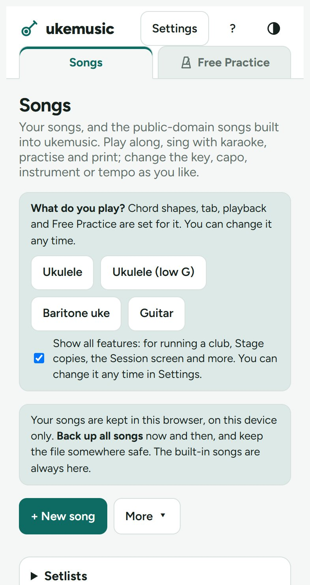

- **Songs** and **Free Practice** are the two tabs at the top.
- The songs that come with ukemusic are out of copyright, ready to play. Tap one to open it.
- **Find** (at the top of the list) searches titles, artists, tags and keys.
- **Setlists** (above the list) holds your setlists (see [Setlists](#setlists)).

## Adding a song

Tap **+ New song**. It asks how:

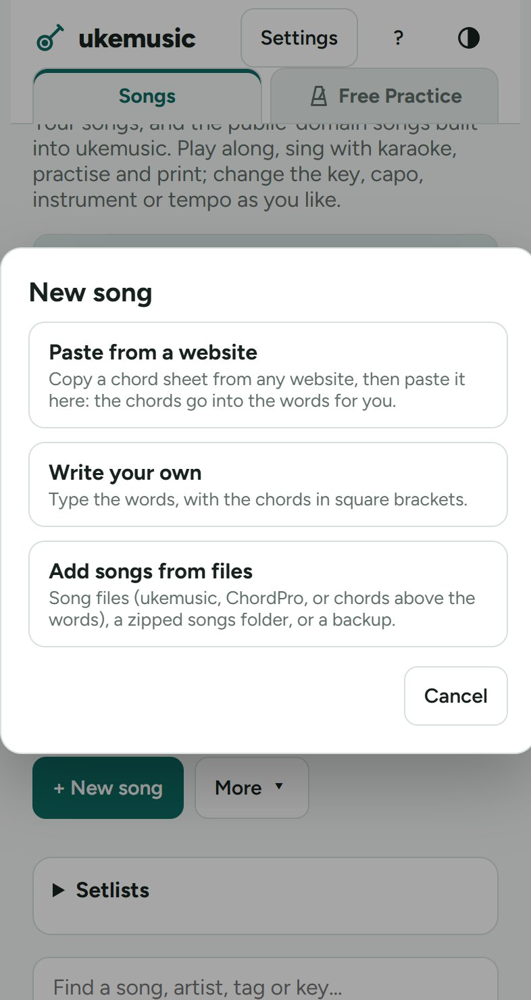

- **Paste from a website:** in the browser, copy a chord sheet from any website (from the title to the last chord), then come back and paste it in. ukemusic moves the chords into the words and finds the parts. Check the title, then **Add the song**.
- **Write your own:** give it a title, then type the words with the chords in square brackets (see [Writing a song: the basics](#writing-a-song-the-basics)).
- **Add songs from files:** song files (ukemusic, ChordPro, or chords above the words), a zipped songs folder from the desktop app, or a backup. For ChordPro, see [ukemusic and ChordPro](../CHORDPRO.md).

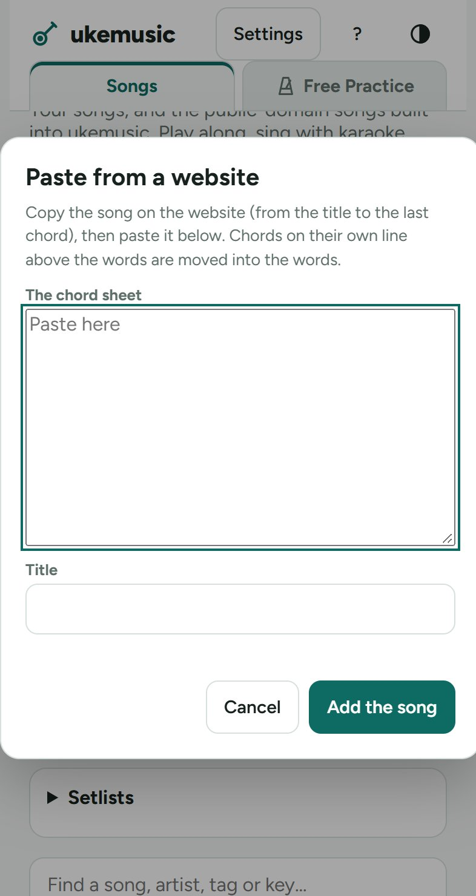

## A song

A song opens as the sheet to play from. From the top:

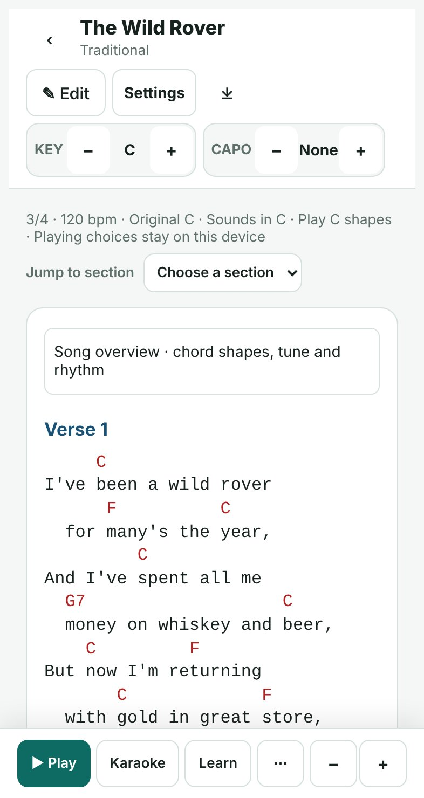

- **‹** goes back to your songs. **✎ Edit** changes the song (see [Changing a song](#changing-a-song)). **Settings** has this song's playing choices; **⤓** downloads it (see [Downloading and printing](#downloading-and-printing)).
- **Key** (**−** and **+**) moves the song up or down; **Capo** plays it with a capo and shows the shapes to finger.
- **Jump to section** goes to a verse or chorus.
- **Song overview** shows the song's chord shapes, its tune and its strum.
- The **player** at the bottom: **Play**, **Restart**, **Strum or pick**, **Karaoke**, **Learn**, **Music stand**, **+ Setlist**, **Session screen**, and the tempo.

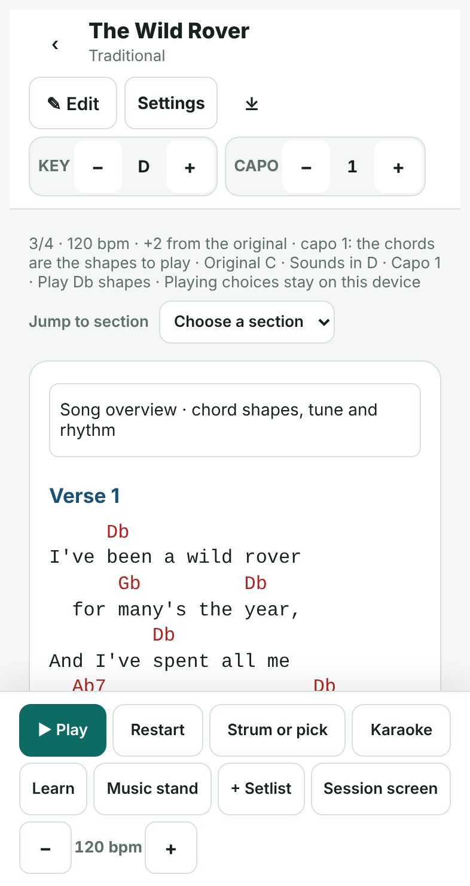

The key, capo, instrument, tempo and other playing choices are kept on this device for this song; they don't change the song itself. **Settings → Reset playing choices** puts them back.

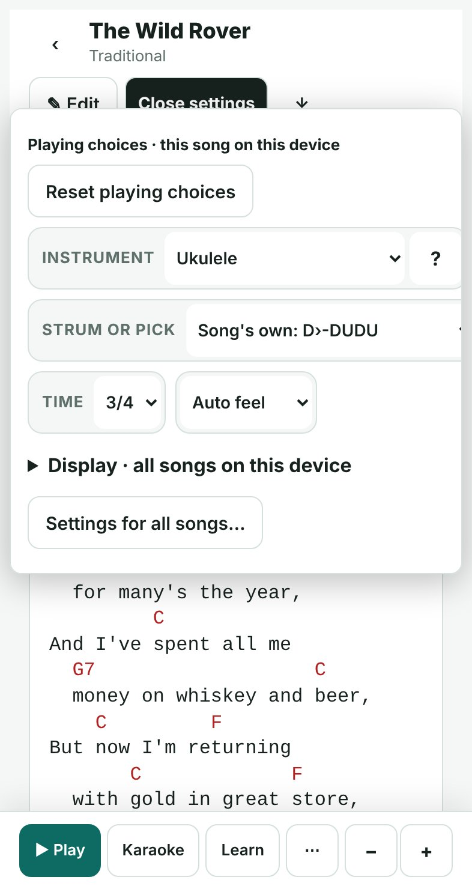

## Playing along

Tap **Play**. ukemusic plays the song on a real ukulele (or guitar) the way it's written, and the sheet follows: the line lights up, with the chord, the strum and the next shapes in the player.

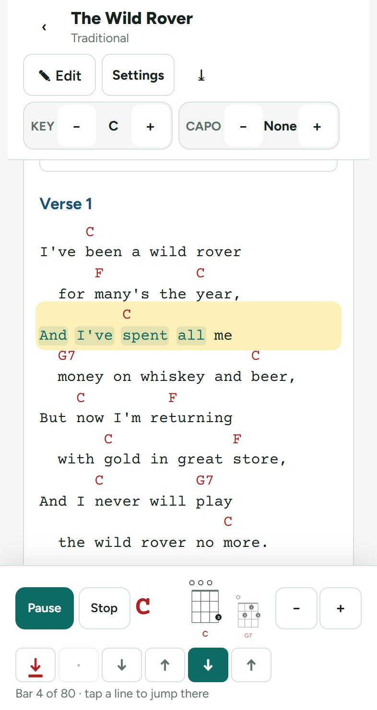

- Tap a line to play from there. **Pause** stops where you are; **Restart** goes back to the start.
- **−** and **+** change the tempo.
- **Strum or pick** plays the song strummed, or picked in a standard pattern.
- **Karaoke** plays it full screen, with big words that light up as you sing.

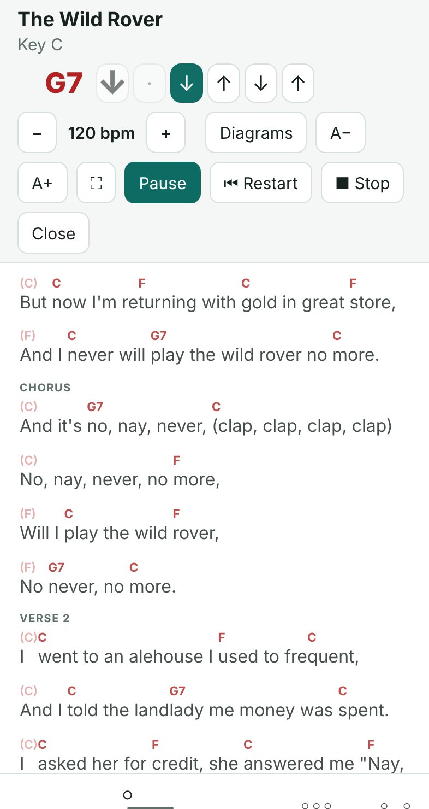

## Learning a song by heart

Tap **Learn** in the player.

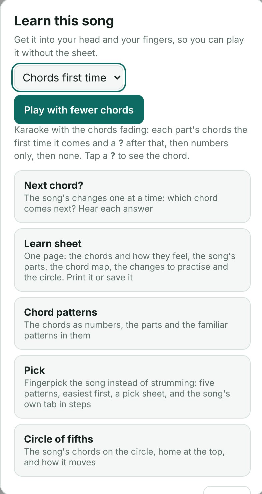

- **Play with fewer chords:** karaoke with the chords fading. Each part shows its chords the first time it comes, then a **?** (tap it to see the chord). Choose **Chord numbers** or **No chords** when you're ready.
- **Next chord?** A quiz on each change: you're playing C, what comes next? Hear each answer before you choose.
- **Learn sheet:** one page with the chords and how each feels, the parts and the hardest changes. Print it or save it as a PDF.
- **Chord patterns**, **Pick** (fingerpicking) and the **Circle of fifths**.

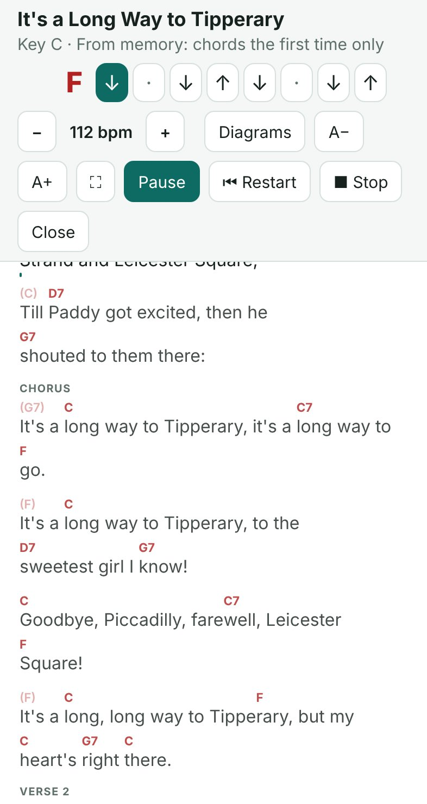

## Writing a song: the basics

A song is plain text: the words, with each chord in square brackets just before the word where it changes. A few more marks give the parts and the strum:

```
{D-DU-UDU}
[[Verse 1]]
I [C]come from Alabama
with my [G7]banjo on my [C]knee
```

- `[C]word`: the chord changes on that word.
- `[[Verse 1]]`, `[[Chorus]]` on a line of their own: a part of the song, by name.
- `{D-DU-UDU}` on a line of its own: the strum, D for down and U for up, - for a gap. It holds until the next one.
- In **✎ Edit**, the buttons above the words put in a chord `[ ]`, a heading `[[ ]]` or a strum `{ }`; **?** opens How to write songs.

Paste a chord sheet from a website and ukemusic writes most of this for you. Everything else you can type (bars, repeats, tab, the tune, picking patterns, key changes) is in [How to write songs](../WRITING.md), with examples; songs from other apps in ChordPro are covered in [ukemusic and ChordPro](../CHORDPRO.md).

## Changing a song

Tap **✎ Edit**. Changes save on this device as you type: there's no Save button.

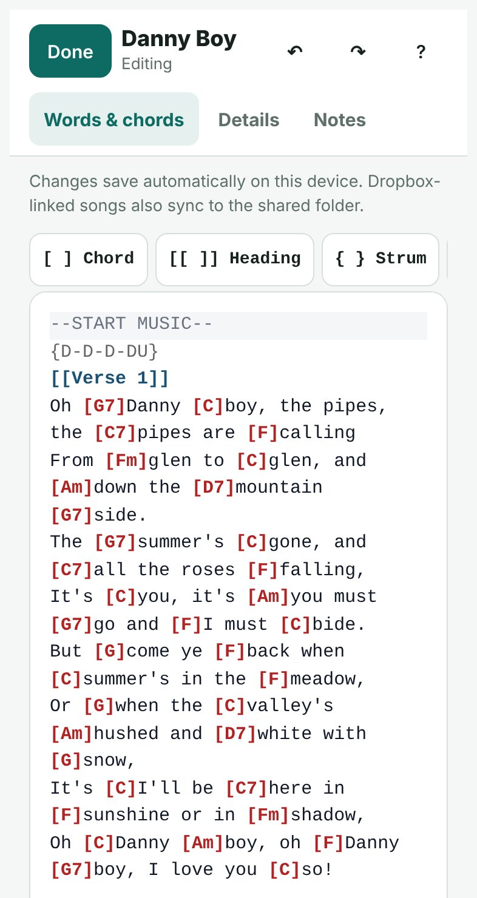

- **Words & chords:** the song as text. The buttons above it put in a chord `[ ]`, a heading `[[ ]]` or a strum `{ }`.
- **Details:** the capo, tempo, time and tags; **Make a copy**, or **Remove from this device**.
- **Notes:** your notes on the song.
- **Done** goes back to the sheet.

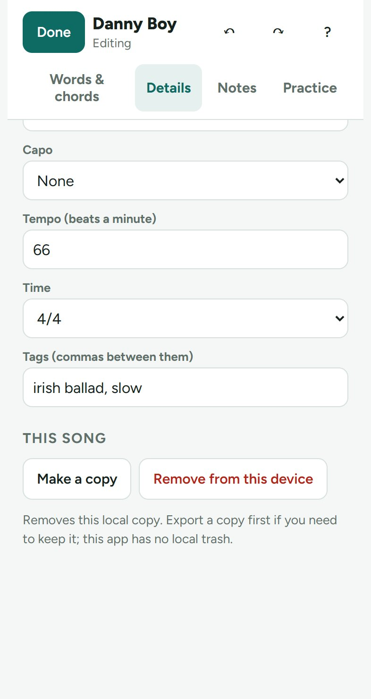

## Free Practice

Tap **Free Practice** at the top. It has 40 exercises with no song needed: warm-ups, chord changes, strumming, fingerpicking, scales and making up tunes.

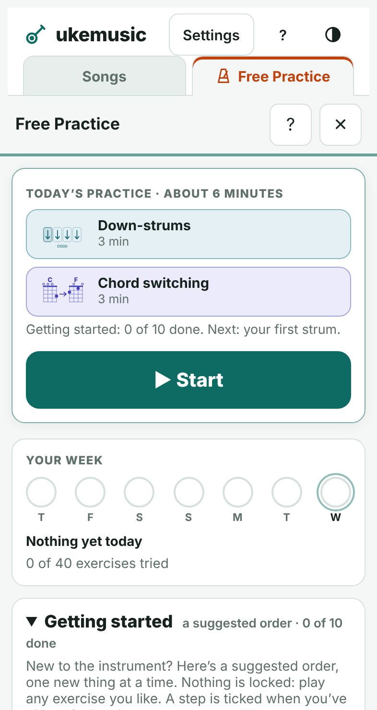

- **Today's practice** picks three exercises for about eight minutes: tap **Start**.
- **Getting started** suggests an order for a beginner, one new thing at a time.
- Each exercise has a moving fretboard and a metronome. **How it works** shows, in pictures, what it does and which finger is which.

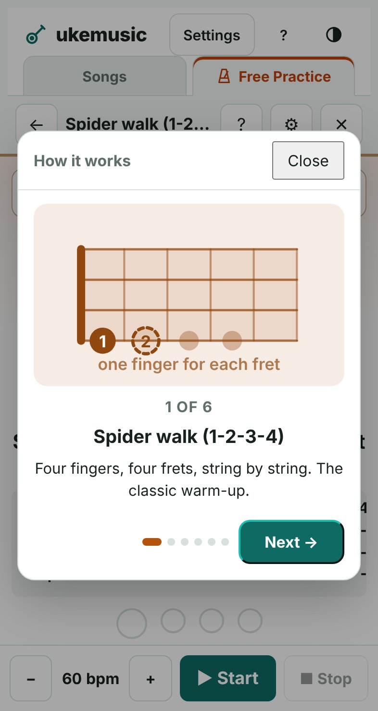

More: the [Free Practice guide](https://markbeachill.github.io/ukemusic/practice-guide.html).

## Setlists

A setlist is the songs for a gig, a jam or a club night, in order.

- **Setlists** (above your songs) → **+ New setlist**, or **+ Setlist** in a song's player to add it to one.
- A setlist's **Music stand** reads it song after song; **Session screen** shows it on a TV for the room.

## The Music stand, on a tablet

Your songs on an iPad or tablet on your music stand, instead of paper: one steady text size, a page at a time. Tap **Music stand** in a song's player, or on a setlist.

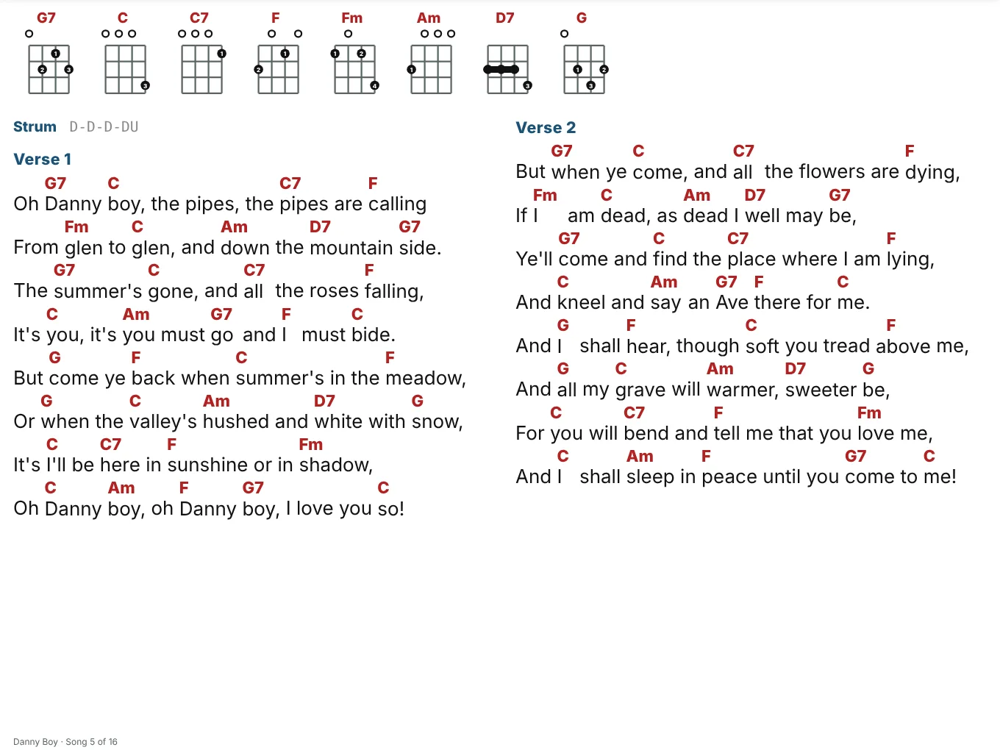

- Tap the **right half** for the next page, and then the next song; the **left half** to go back.
- Tap the **top**, or **☰ Menu**, for the menu: **Close**, the songs to jump to, the text size, and **?** for the instructions.
- A Bluetooth page-turner pedal works too.

## Downloading and printing

Tap **⤓** on a song.

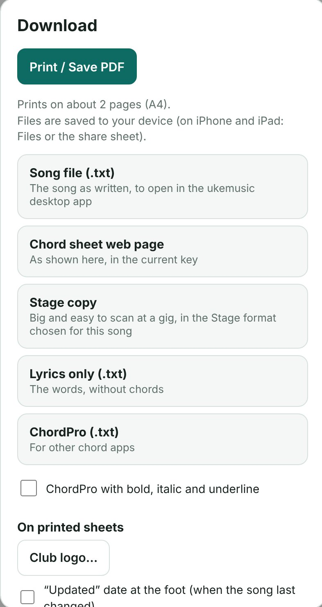

- **Print / Save PDF:** the song to print, or to save as a PDF.
- **Song file**, **Chord sheet web page**, **Stage copy** (big and bold, for playing from), **Lyrics only** and **ChordPro**.
- On an iPhone or iPad, files are saved to the **Files** app.

## Keeping your songs safe

Your songs, and any you've added or changed, are kept in the browser on this device.

- **More → Back up all songs** saves them all in one file. Keep it somewhere safe: iCloud Drive, Google Drive or your computer.
- **More → Add songs from files** brings a backup back, on this device or another.
- Deleting the Home Screen icon, or clearing the browser's website data, deletes the songs on this device. Back up first.

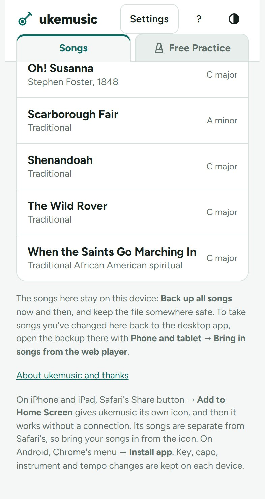

### With the desktop app

- **Songs from the desktop app:** on the computer, the library's **Phone and tablet…** saves your songs in one file. Open it here with **More → Add songs from files**.
- **Back to the desktop:** **Back up all songs** here, then on the computer **Phone and tablet… → Bring in songs from the web player**.
- **One set of songs everywhere:** keep the desktop app's songs folder in Dropbox and connect with **More → Dropbox…**. See [Sharing songs through Dropbox](https://markbeachill.github.io/ukemusic/dropbox.html).

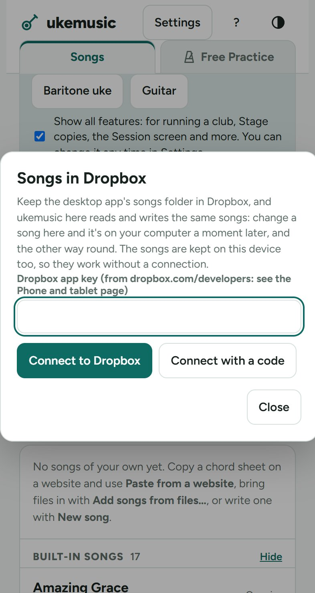

## Where next

- [The main user guide](user-guide.md), for the desktop app.
- [How to write songs](../WRITING.md): everything you can type in a song.
- [ukemusic and ChordPro](../CHORDPRO.md): what it reads from ChordPro files and writes back.
- [Phone and tablet](https://markbeachill.github.io/ukemusic/phone.html): more on the Home Screen app and its songs.
