# The ukemusic user guide

**The guides:** this user guide · [for phones and tablets](user-guide-phone.md) · [How to write songs](../WRITING.md) (everything you can type in a song) · [ukemusic and ChordPro](../CHORDPRO.md)

**On a phone or tablet?** See [the guide for phones and tablets](user-guide-phone.md): the web player, step by step, with pictures from a phone.

How to use ukemusic, step by step. It covers the desktop app (Windows, Mac and Linux) and the web player (any browser, on a phone, tablet or computer); where they differ, it says so. [Writing a song: the basics](#writing-a-song-the-basics) shows what to type; everything else is in [How to write songs](../WRITING.md).

## Getting started

- **In a browser:** open the [web player](https://markbeachill.github.io/ukemusic/app/). Nothing to install, no account. On a phone or tablet, add it to your Home Screen (see [On a phone or tablet](#on-a-phone-or-tablet)).
- **On your computer:** download the desktop app from the [website](https://markbeachill.github.io/ukemusic/#get) and install it.

The first time, ukemusic asks what you play: ukulele (high or low G), baritone ukulele or guitar. Chord shapes, tab, playback and Free Practice follow your answer. You can change it later in Settings.

ukemusic comes with songs that are out of copyright, ready to play. Open one and press **Play** to hear it.

## The home screen: Songs and Free Practice

The two tabs at the top are the two places in ukemusic:

- **Songs:** your songs and setlists.
- **Free Practice:** exercises with no song needed (see [Free Practice](#free-practice)). **Songs** takes you back.

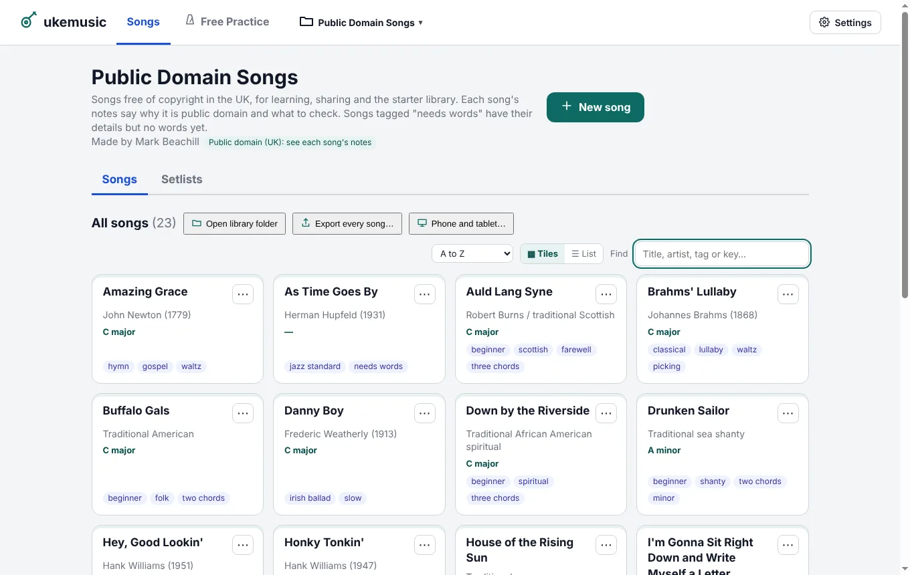

On the desktop:

- **Tiles** or **List** (above the songs) shows the songs as tiles, or as a list with the artist, key, instrument, tags and when each was last changed. Tiles have a menu to sort them; in the list, click a column's heading.
- **Find** searches titles, artists, tags and keys. Click a tag on a song to see every song with it.
- **⋯** on a song: add it to a setlist, copy or move it to another library, or archive it (put it away; **Archived songs**, at the end of the list, brings it back).
- **Songs** and **Setlists** under the library's name switch between the songs and your setlists.

## Adding a song

Press **New song**. It asks how:

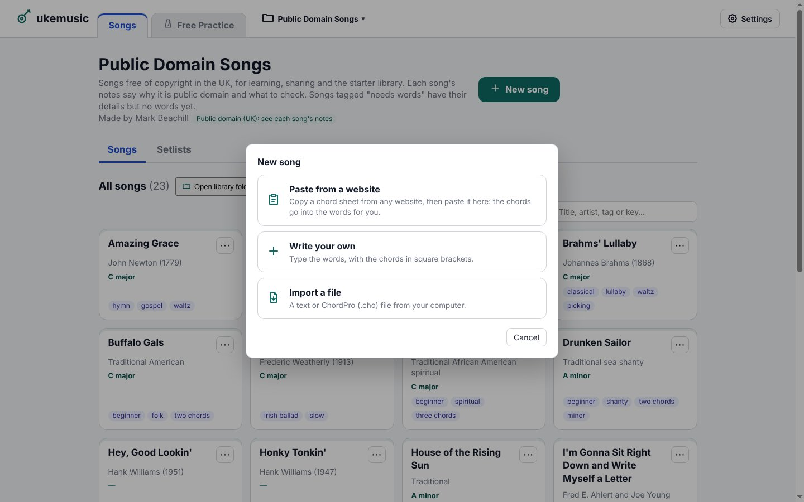

- **Paste from a website:** copy a chord sheet from any website (from the title to the last chord), then paste it in. ukemusic moves the chords into the words and finds the parts.
- **Write your own:** give it a title, then type the words with the chords in square brackets.
- **Import a file:** a text or ChordPro (`.cho`) file from your computer. (Web player: **Add songs from files**, which also takes a zipped songs folder or a backup.) A club's ChordPro songbook can come in a whole folder at once: see [ukemusic and ChordPro](../CHORDPRO.md).

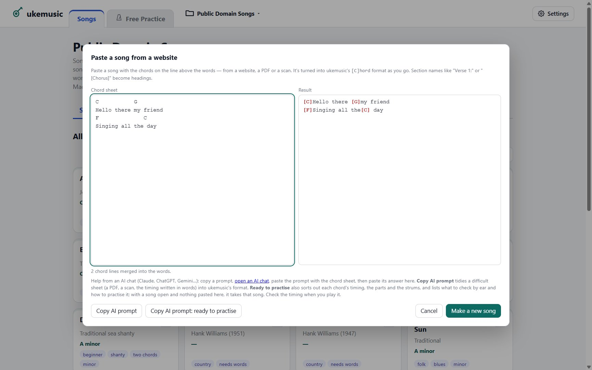

After pasting, check the result: the chords should sit in the words, and the parts should have headings. Press **Play** and listen; if the timing is wrong, see [Adding songs](https://markbeachill.github.io/ukemusic/songs.html) for an AI prompt that fixes difficult sheets.

A new, pasted or imported song opens ready to edit. Press **Save** to keep it.

## Writing a song: the basics

A song is plain text: the words, with each chord in square brackets just before the word where it changes. A few more marks give the parts and the strum:

```
{D-DU-UDU}
[[Verse 1]]
I [C]come from Alabama
with my [G7]banjo on my [C]knee
```

- `[C]word`: the chord changes on that word.
- `[[Verse 1]]`, `[[Chorus]]` on a line of their own: a part of the song, by name.
- `{D-DU-UDU}` on a line of its own: the strum, D for down and U for up, - for a gap. It holds until the next one.
- On the desktop, the **Write** tab has buttons that put these in for you; **How to write** (F1) opens the full guide.

Paste a chord sheet from a website and ukemusic writes most of this for you. Everything else you can type (bars, repeats, tab, the tune, picking patterns, key changes) is in [How to write songs](../WRITING.md), with examples; songs from other apps in ChordPro are covered in [ukemusic and ChordPro](../CHORDPRO.md).

## A song: reading and editing

A song opens as the sheet to play from. Down the left edge is a strip of the song's tabs: **Details** (artist, year, key, tempo, time, tags), **Links**, **Exports**, **Notes** and **ChordPro** fields. Click one and it opens in a column beside the sheet; it opens on the notes, if the song has any (a dot on **Notes** says so), or on the tab you last looked at.

- Click the open tab again, or **Hide** at the bottom of the strip, and the sheet has the whole width. Any tab (or **Show**) brings the column back.
- ukemusic keeps it the way you left it, from song to song.

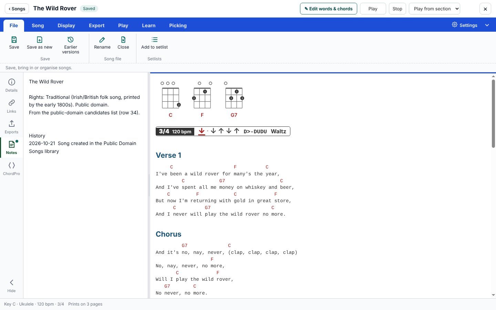

Along the top:

- **‹ Songs** and **×** close the song and go back to your songs.
- **Saved** (or **Not saved**) says whether there's anything to save.
- **✎ Edit words & chords** (or F2) shows the words and chords beside the sheet, to change them. It turns into **Done**, which puts them away again.
- **Play**, **Stop** and **Play from section**.

Under that, the tabs hold the tools: **File**, **Song**, **Display**, **Export**, **Play**, **Learn** and **Picking**. The line under the tabs says what the button under your mouse does.

### Editing

Press **✎ Edit words & chords**. The words and chords are on the left, the sheet on the right, kept in step: scroll one and the other follows, and click a line of the sheet to go to it in the words.

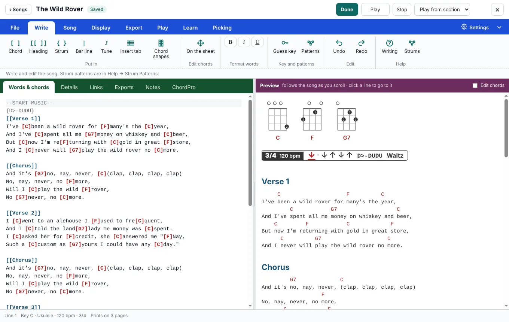

- Type the words with the chords in square brackets (see [Writing a song: the basics](#writing-a-song-the-basics)); [How to write songs](../WRITING.md) has everything else you can type.
- The **Write** tab has buttons for what's harder to type (a chord, a heading, a strum, a bar line, tab), Undo and Redo, and **How to write** (F1), which opens [How to write songs](../WRITING.md) in the app.
- **Words & chords** joins the top of the strip while you edit, and the column is always open; **Done** goes back to the tab you were reading (or to the sheet alone, if the column was hidden).

**Edit chords on the sheet** lets you move chords with the mouse instead: turn it on with **Write → On the sheet**, the **Edit chords** box over the sheet, or a right-click on the sheet. Then drag a chord to the word where it's played, click a chord to change it or take it out, or click in the words to put one there.

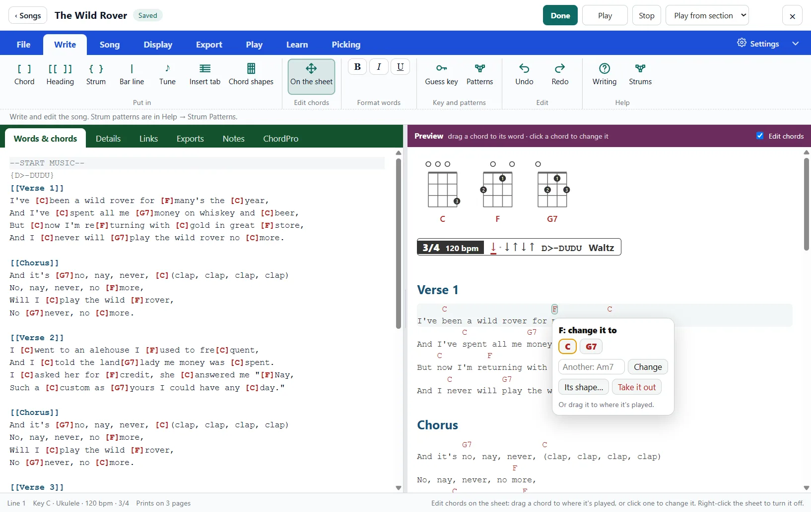

## Saving, and taking changes back

Anything you change waits for **Save**, whether you're editing or not: the words and chords, and the song's settings (its key, tempo, picking pattern, instrument and the rest).

- When something has changed, **Save** and **Discard** appear at the top, beside **Not saved**.
- **Discard** asks first, then takes the song back to how it was last saved.
- **Done** doesn't save: your changes stay until you Save or Discard them.
- If you close a song with changes, ukemusic asks whether to save them.
- Every save keeps the one before. **File → Earlier versions** shows them, and puts one back.

Two things are never saved with the song: **Practice speed** (Play tab) and trying the song **higher or lower** (Song tab), until you keep that key.

## Key, capo, instrument and tempo

The **Song** tab has the song's own settings:

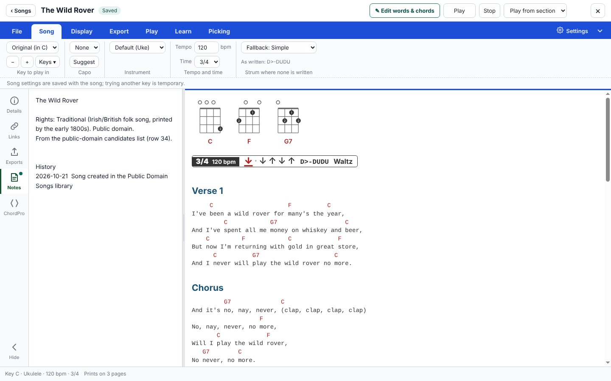

- **Key to play in:** **−** and **+** move the song a semitone at a time, to try it higher or lower. **Save this key as a version** keeps it as a second key ("Song (in F)" in your songs); **Make this the song's key** rewrites the song in it.
- **Capo:** play with a capo; the sheet shows the shapes to finger. **Suggest** offers capo positions with easier shapes.
- **Instrument:** this song for another instrument. **Default** means it follows yours.
- **Tempo and time,** and **Strum where none is written**: the strum played where the song has none of its own.

## How the sheet looks

The **Display** tab changes how the song looks on screen and when printed: chord diagrams (which, where and how big), text size, how strums look, and the layout (chords above the words, in the words, or in columns).

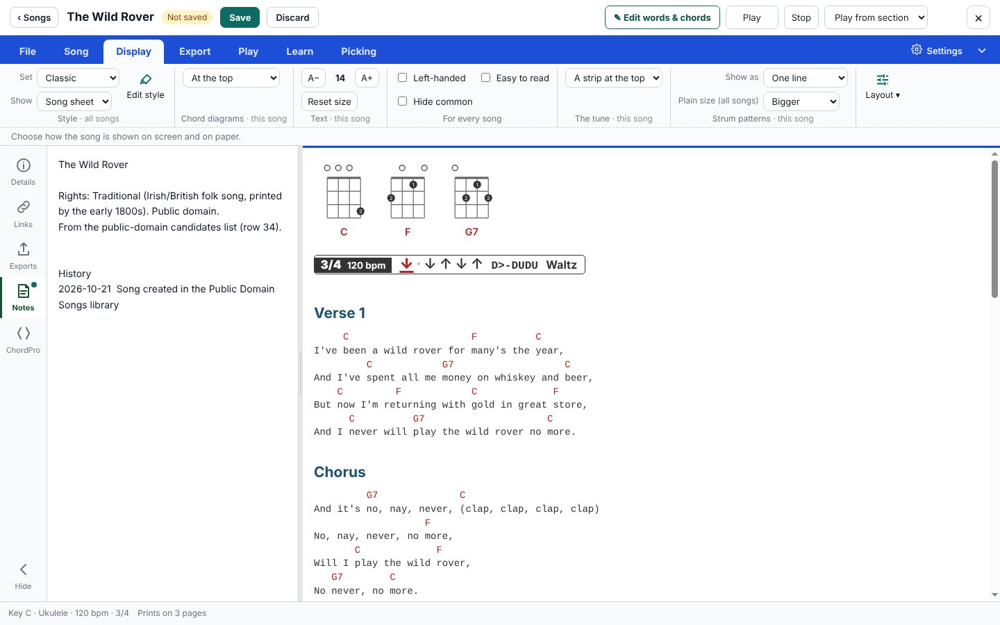

- Click a chord diagram on the sheet to choose another shape for that chord; it's kept with the song.
- **Settings → All songs** sets these for every song; Display changes them for this one.

## Playing along

Press **Play** (top right, or on the **Play** tab, or F5). ukemusic plays the song on a real ukulele (or guitar) the way it's written, and the sheet follows: the line lights up, with the chord now, the strum and the next shapes above it.

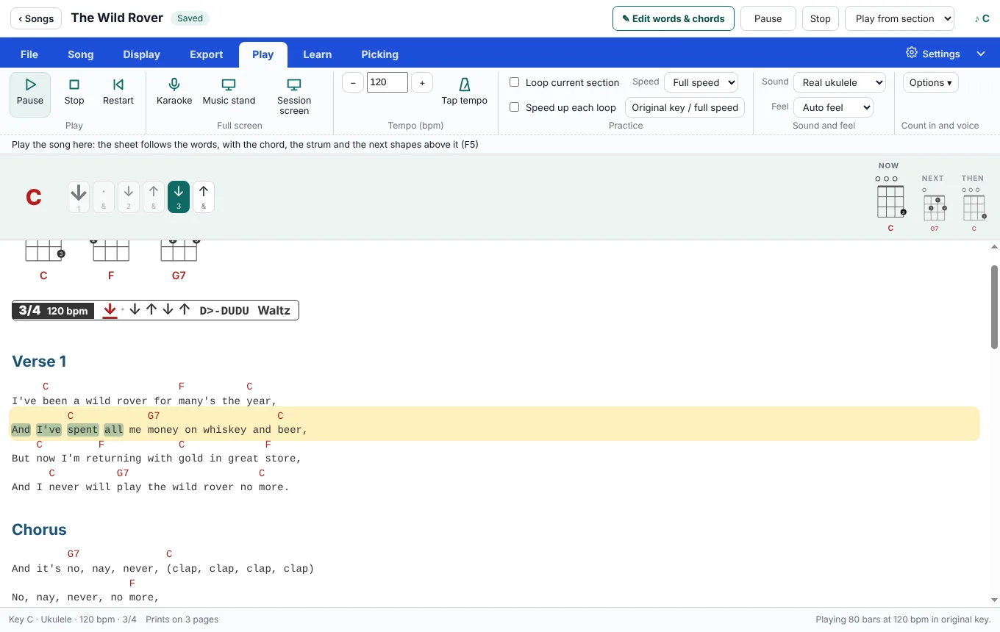

- **Play from section** starts at a verse or chorus. With **Start at the cursor** ticked (Play tab), it starts at the line you last clicked.
- **Tempo:** **−** and **+**, or **Tap tempo**. This is the song's tempo, and is saved with it.
- **Practice speed** (Play tab): play slower without changing the song's tempo. **Loop current section** repeats the part you're on, and **Speed up each loop** adds a little each time round. **Original key / full speed** puts it all back.
- **Sound** and **Feel** (Play tab): the instrument's sound, and swing or shuffle.

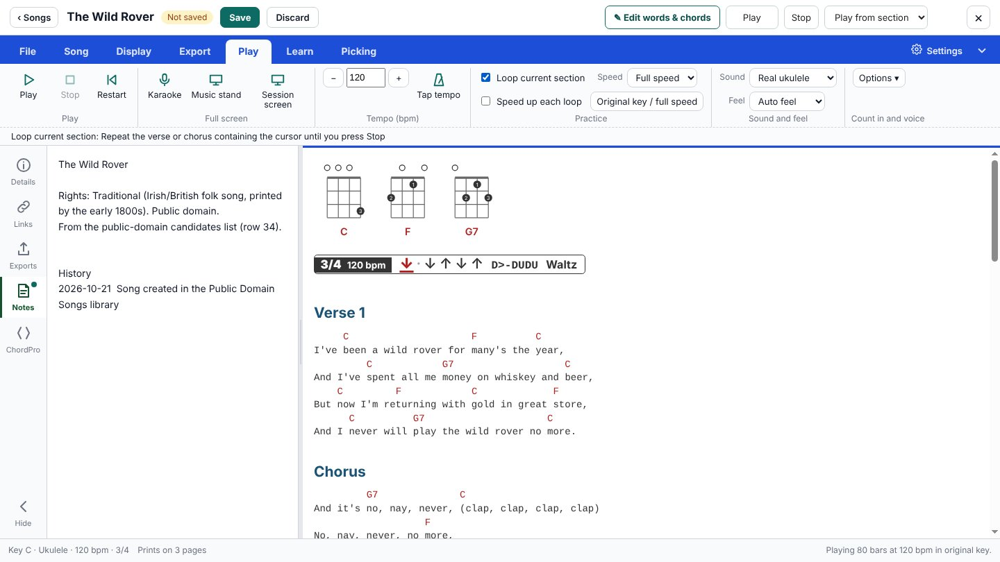

**Karaoke** (Play tab) plays the song full screen, with big words that light up as you sing, the chord above each word and the shapes down the side. Tap a line to start from there; **Esc** closes it.

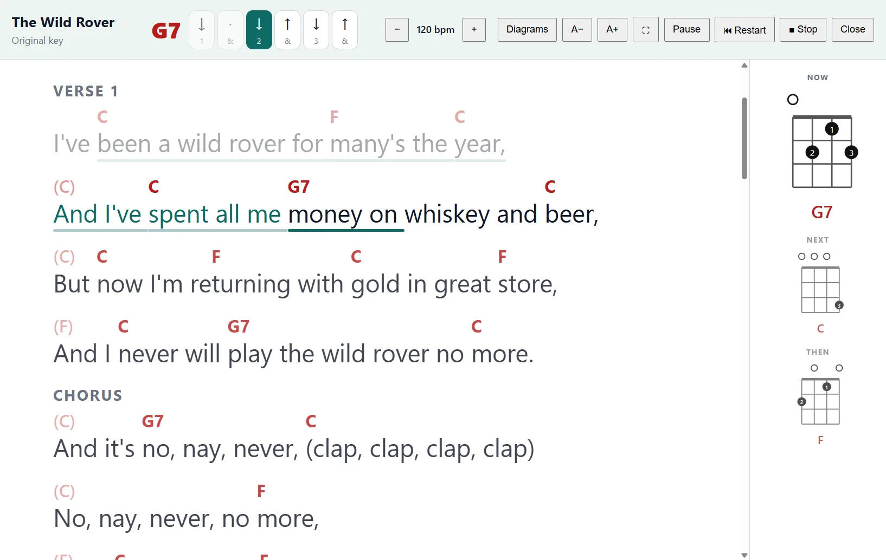

## Learning a song by heart

The **Learn** tab helps you play a song without the sheet. Its buttons, from left to right:

- **Play with fewer chords** (From memory): karaoke with the chords fading. Each part shows its chords the first time it comes, then a **?**; next time try the numbers only, then nothing. The ones you peek at become your trouble spots.
- **Next chord?** A quiz on each change: you're playing C, what comes next? Hear each answer before you choose.
- **Practise trouble spots:** the places you peeked at or got wrong, looped slowly.
- **Changes:** every chord change in the song, hardest first, with what each finger does, and a drill or a one-minute challenge for each. **Shapes** drills the song's chord shapes in Free Practice.
- **Numbers** on the sheet (I, IV, V…), and **Play in new key** from memory.
- **Learn sheet:** one page to print, with the chords and how each feels, the parts, the patterns, the hardest changes and the circle of fifths.
- **Circle of fifths** and **Patterns:** how the song is put together.

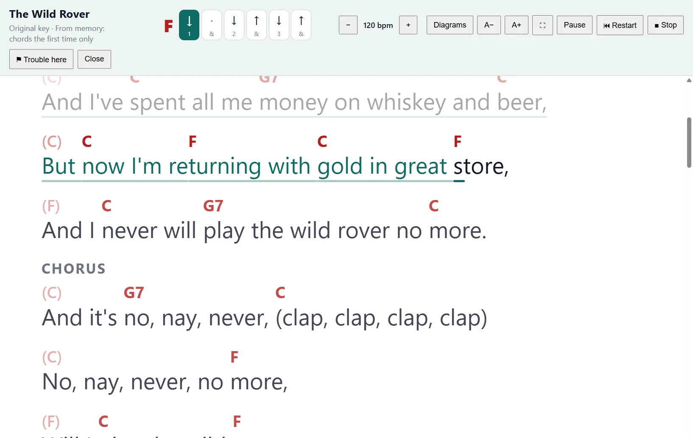

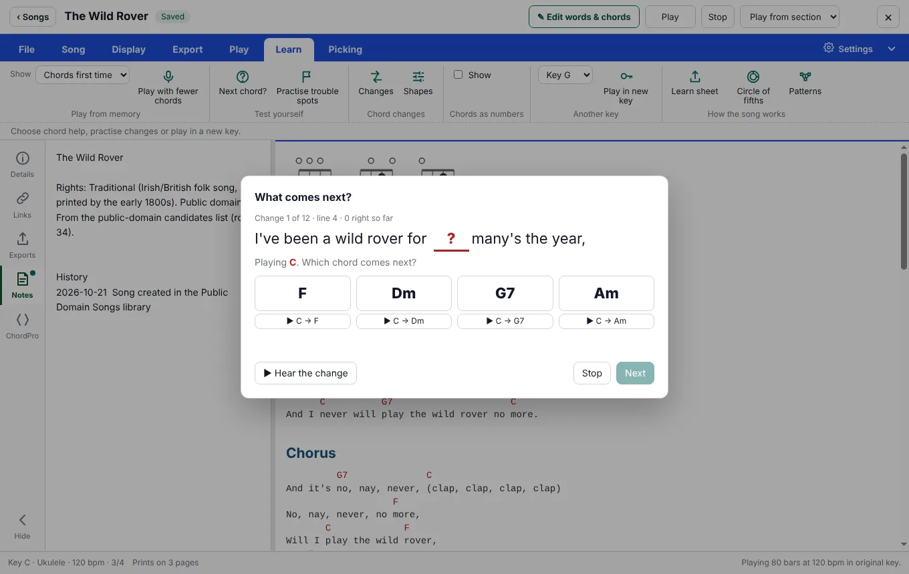

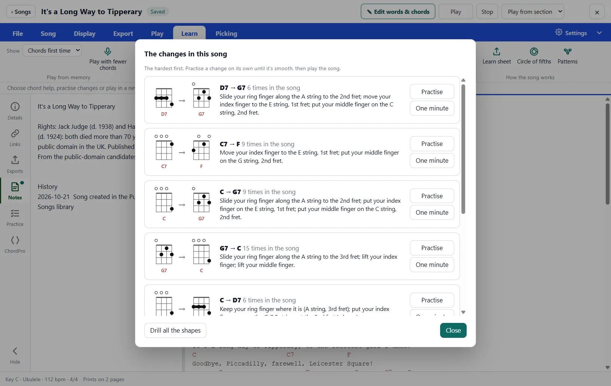

How Learn works things out, and how far to trust it: [How Learn works](explanation/how-learn-works.md).

## Fingerpicking

The **Picking** tab plays a strummed song picked instead. (It's in the simple view for a song that has picking or tab.)

1. Choose a **Picking pattern**: five standard patterns, easiest first, from one string a beat to the alternating thumb.
2. Press **Play**: the strip above the sheet shows each string as it's picked.
3. **Pick sheet** makes a page to print: the pattern counted out, the chord boxes, and the song as tab with the words under it.
4. **Play the tune** plays the song's tune quietly over the picking (when the tune is written in: see [How to write songs](../WRITING.md)).

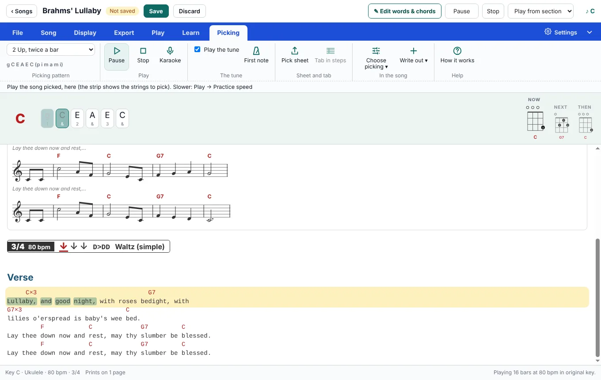

A song with tab? **Tab in steps** teaches it in four steps: the chords strummed, the picking on open strings, both slowly, then both in time.

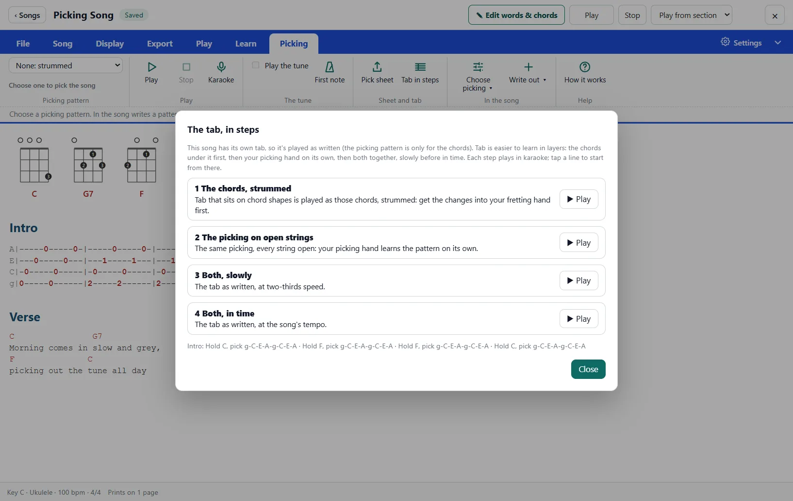

## Free Practice

**Free Practice** (the tab on the home screen, or in the web player) has 40 exercises, no song needed: warm-ups, chord changes, strumming, fingerpicking, scales and making up tunes.

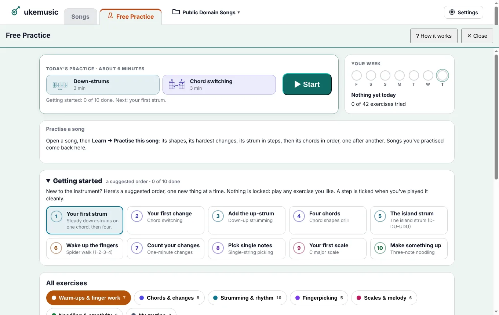

- **Today's practice** picks three exercises for about eight minutes. Press **Start**.
- **Getting started** is a suggested order for a beginner, one new thing at a time. Nothing is locked.
- Open any exercise, then **Start** and **Stop** (or Space). The notes or chords show on a fretboard in time with the metronome. The speed is at the bottom; the settings are behind the ⚙.
- **How it works** shows, in pictures, what the exercise does and which finger is which.
- **That was clean** records a clean round at that speed; ukemusic remembers your best.

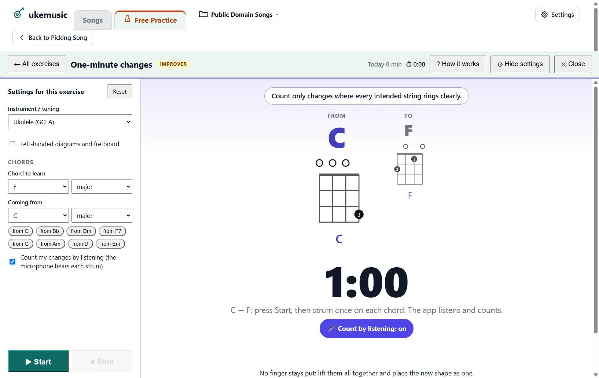

**One-minute changes:** how many clean changes between two chords in a minute? Three beeps to get ready, a beep at ten seconds to go, three to stop. Turn on **Count by listening** and the microphone counts your strums; or count in your head.

More: the [Free Practice guide](https://markbeachill.github.io/ukemusic/practice-guide.html), and the [list of exercises](https://markbeachill.github.io/ukemusic/practice/).

## Setlists

A setlist is the songs for a gig, a jam or a club night, in order, in the keys you play them.

- **Desktop:** the library's **Setlists** tab: **New setlist**, then add songs from the list beside it (or **⋯ → Add to a setlist** on a song, or **File → Add to setlist** in a song).
- **Web player:** **Setlists** in your songs, or **+ Setlist** on a song.

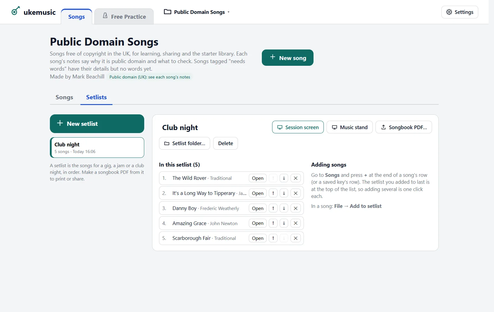

From a setlist: **Music stand** to read it yourself, **Session screen** for the room, and (desktop) **Songbook PDF** for one PDF of the whole set. Setlists are text files in the songs folder's Setlists folder; with Dropbox, the web player shares them.

## Reading at a gig: Music stand and Session screen

Which to use:

- **The Music stand:** you, reading on an iPad or laptop on your own stand. One steady text size; a long song turns a page.
- **The Session screen:** the whole room, on a TV or projector. Each song as big as it will go, on one screen.
- **A Stage copy:** paper (see [Printing and exporting](#printing-and-exporting)).

### The Music stand

Open it from a song (**Play → Music stand**) or a setlist (**Music stand**). The first time, it shows how:

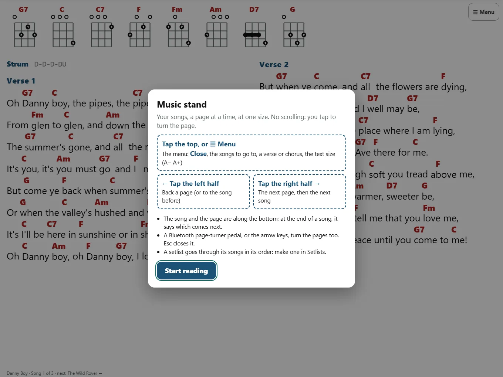

- Tap (or click) the **right half** for the next page, and then the next song; the **left half** to go back.
- Tap the **top**, or **☰ Menu** in the corner, for the menu: **Close**, the songs to jump to, a verse or chorus to go to, the text size (**A−** and **A+**), and **?** for the instructions.
- A Bluetooth page-turner pedal and the arrow keys turn the pages too. **Esc** closes it.

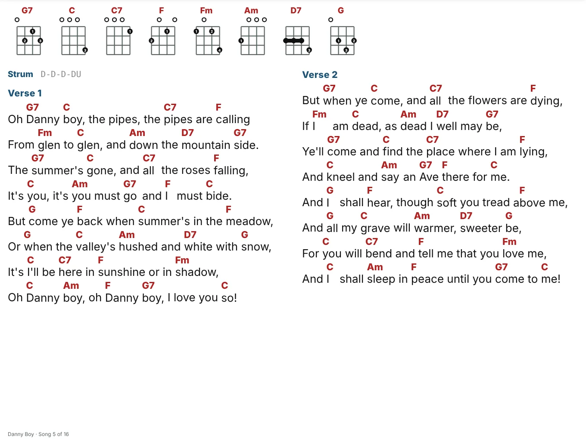

### The Session screen

Open it from a song (**Play → Session screen**, with all features) or a setlist (**Session screen**). With a TV or projector plugged in, the song goes full screen there, and the laptop shows what's next. The arrow keys, a presentation clicker or a tap move to the next song.

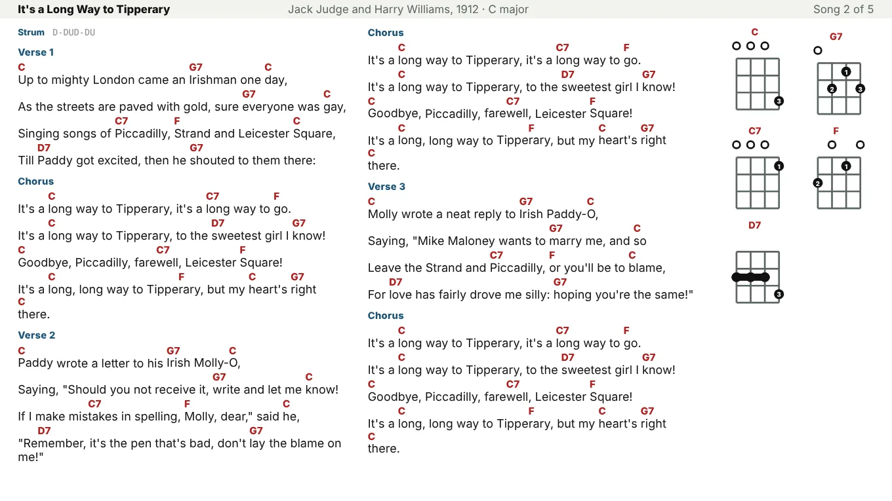

## Printing and exporting

**Export → Export now** (or Ctrl+E) makes files from the song, into its exports folder:

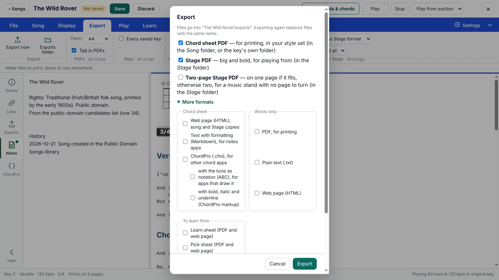

- **Chord sheet PDF:** the song to print, in your style.
- **Stage PDF:** big and bold, for playing from. Where its chords go (Auto, above, in the words, Heavy) is on the Export tab.
- **Two-page Stage PDF:** one page if it fits, otherwise two, so there's no page to turn.
- **More formats:** a web page, words only, Markdown, ChordPro, and learn and pick sheets.
- Tick **Make these my usual** to have the same ones ticked next time.

A **songbook** is one PDF of a setlist, with a cover and contents: **Songbook PDF** on the setlist.

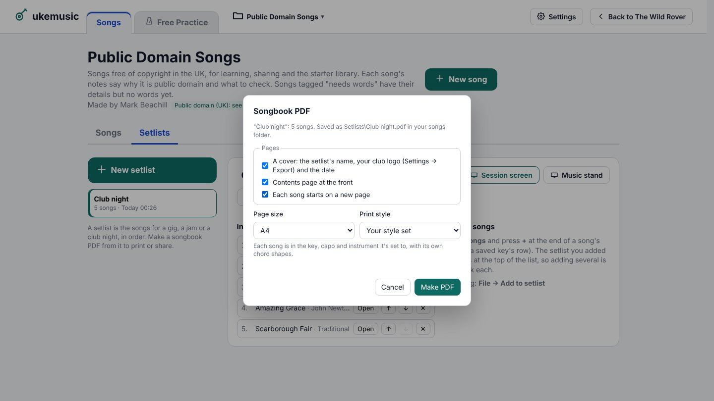

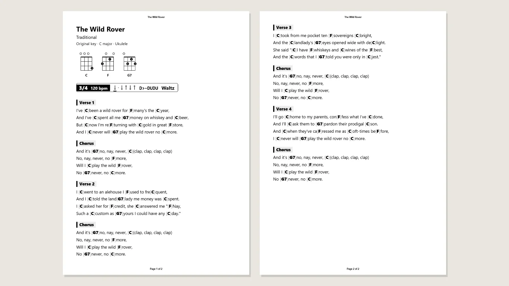

The web player saves sheets from **Download** (⤓ on a song). See real files in the [gallery](https://markbeachill.github.io/ukemusic/gallery.html).

## Settings and the simple view

**Settings** on the home screen is for all your songs. In a song, the ⚙ **Settings** at the right of the tabs also has **This song**: a setting there is kept with that song (untick **Use default** to give it its own value).

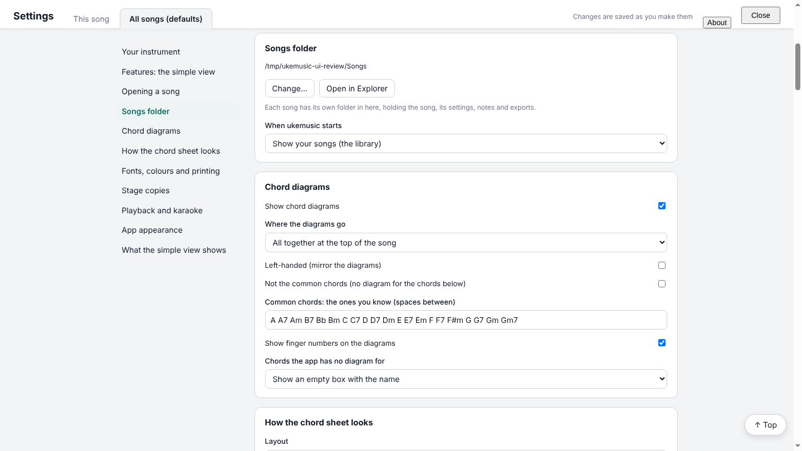

The first three are the ones to look at first:

- **Your instrument:** what you play. New songs, chord shapes, tab and playback follow it.
- **Features: the simple view.** At first ukemusic shows what someone new needs. Tick **Show all features** here (or press **More features** on the tabs) to see everything. **What the simple view shows**, at the end of Settings, chooses one feature at a time. Hidden isn't off: a song that uses a hidden feature plays and prints as before.
- **Opening a song:** tick it to have every song open with the words and chords showing.

Then **Songs folder**, **Chord diagrams** (including **Left-handed**), **How the chord sheet looks**, **Fonts, colours and printing**, **Stage copies**, **Playback and karaoke** and **App appearance**.

## On a phone or tablet

The [guide for phones and tablets](user-guide-phone.md) covers this step by step. In short: the web player is ukemusic in the browser. It has the songs, playing along, karaoke, Learn, Picking, the Music stand, the Session screen, setlists and Free Practice.

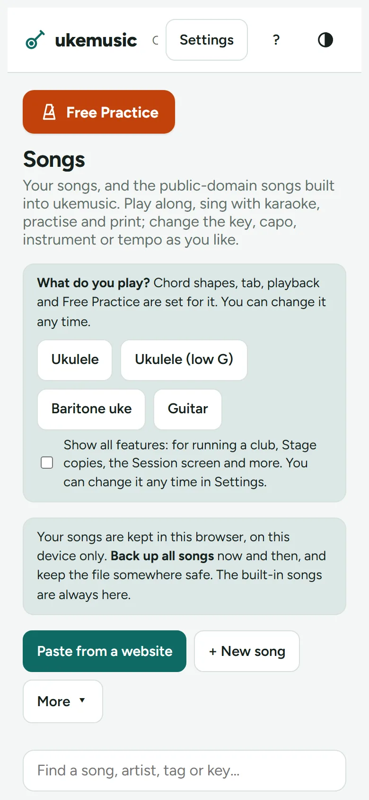

- **Put it on your Home Screen:** in Safari on an iPad or iPhone, **Share → Add to Home Screen**; in Chrome on Android, **⋮ → Install app**. Then open it from its icon: it works without a connection.
- **A song:** **Key**, **Capo** and **Instrument** under the title; **Play**, **Karaoke**, **Music stand** and **Learn** in the player bar. These choices are kept on the device.
- **✎ Edit** (✎ Edit words & chords on a bigger screen) changes a song; changes save on the device as you type.

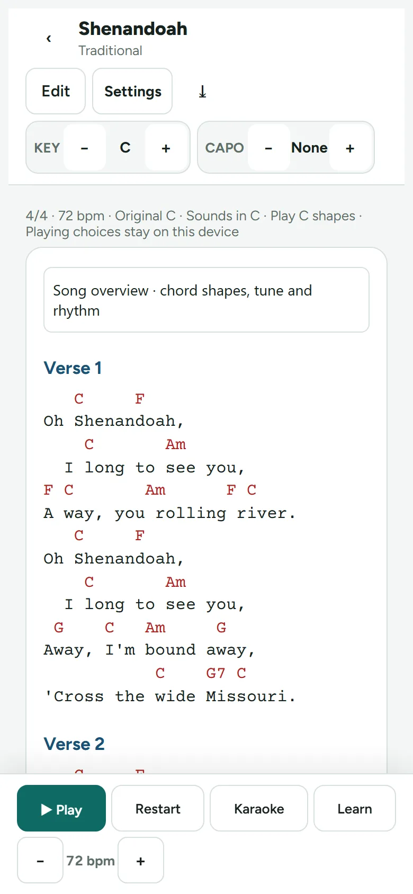

On an iPad or iPhone, the Home Screen app keeps its own songs, separate from Safari's. More: [Phone and tablet](https://markbeachill.github.io/ukemusic/phone.html).

## Keeping your songs safe, and moving them

- **Desktop:** your songs are folders in your songs folder (Settings → Songs folder): one folder per song, with the song as a text file. Back up that folder as you would any other.
- **Web player:** songs are kept in the browser on that device. **More → Back up all songs** saves them all in one file; keep it somewhere safe. Deleting the Home Screen icon or clearing the browser's data deletes them.
- **Desktop to tablet and back:** the library's **Phone and tablet…** saves your songs in one file for the web player (**Add songs from files** there), and brings back the songs you wrote or changed on the tablet.

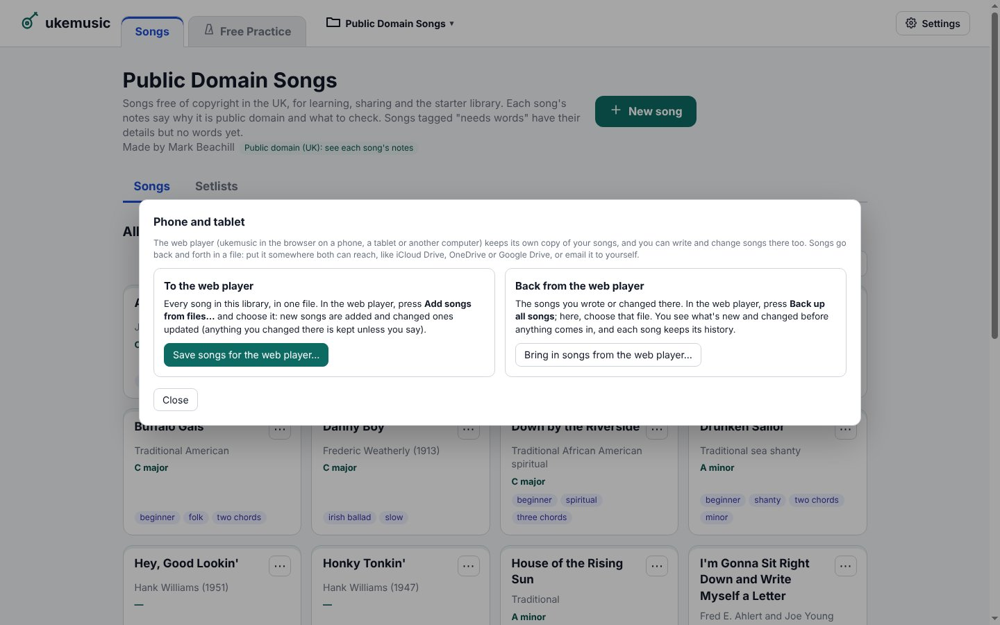

- **One set of songs everywhere:** keep the desktop app's songs folder in Dropbox, and connect the web player to it with **More → Dropbox…**. See [Sharing songs through Dropbox](https://markbeachill.github.io/ukemusic/dropbox.html), which also covers sharing with a club or band.

## Where next

- [How to write songs](../WRITING.md): everything you can type in a song.
- [ukemusic and ChordPro](../CHORDPRO.md): what it reads from ChordPro files and writes back.
- [Adding songs](https://markbeachill.github.io/ukemusic/songs.html), with AI prompts for difficult sheets.
- [What's new](../CHANGELOG.md) in each version.
- Questions and ideas: [ukemusic on GitHub](https://github.com/markbeachill/ukemusic).
